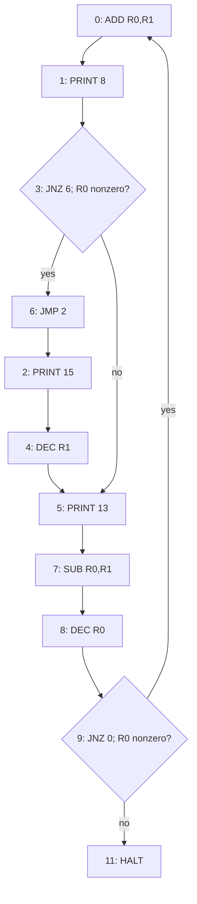

# Length-10 exhaustive search

## Search result

The exhaustive Metal search evaluated every length-10 program: `16^10 = 1,099,511,627,776` candidates. Each candidate's ten nibbles are placed at memory addresses 0–9; the remaining six memory cells are zero. A program scores only if it halts, and its score is the number of decimal characters it printed. The search completed with no errors.

| Result | Count |
| --- | ---: |
| Candidates searched | 1,099,511,627,776 |
| Halted | 961,335,608,296 |
| Cycled | 138,176,019,480 |
| Errors | 0 |
| Maximum output length | 1,173 characters |
| Tied winners | 50 |

The search command reports the first of the 50 tied winners:

```text
[1, 8, 8, 15, 6, 8, 13, 2, 5, 15]
```

The full winner set is now saved in [`metal-search-length-10-winners-2026-11-25.jsonl`](../c-impl/benchmarks/results/metal-search-length-10-winners-2026-11-25.jsonl). The winners fall into four parameterized families of 12 programs each, plus two special layouts.

## Categories of all 50 winners

The 48 regular winners are generated by four short patterns. In the table, `x` ranges from 10 through 15, and the two choices for `(a,b)` are both included. Each row therefore describes `6 × 2 = 12` programs.

| Family | Program pattern | Tail pair `(a,b)` | Count |
| --- | --- | --- | ---: |
| A | `[1,8,x,8,8,15,4,a,b,15]` | `(2,3)` or `(3,2)` | 12 |
| B | `[2,8,x,8,8,15,4,a,b,15]` | `(1,5)` or `(5,1)` | 12 |
| C | `[8,x,1,8,8,15,4,a,b,15]` | `(2,3)` or `(3,2)` | 12 |
| D | `[8,x,2,8,8,15,4,a,b,15]` | `(1,5)` or `(5,1)` | 12 |

The remaining two winners are:

```text
[1,8,8,15,6,8,13,2,5,15]
[1,8,8,15,6,8,15,2,5,15]
```

Together, `4 × 12 + 2 = 50`. The JSONL file gives each program's decimal candidate ID and exact vector.

### What the 48 regular winners share

All four patterns share the loop layout from addresses 3–9. Address 3 prints 8. Address 5 is `JNZ 4`: when R0 is nonzero, execution jumps to address 4, which prints 15, then increments R1 at address 6. When R0 is zero, the branch skips both of those instructions. Both paths execute the two arithmetic instructions at addresses 7–8, then address 9 jumps back to address 0 unless R0 is zero.

Each of the 241 loop passes prints `x` and 8. The nonzero path adds one print of 15 on 225 passes; the zero path omits that print on 16 passes. Since every `x` here is two-digit, for `x = 10` through `14` the output counts are 241 copies of `x`, 241 copies of 8, and 225 copies of 15. Their character total is `241 × 2 + 241 × 1 + 225 × 2 = 1,173`.

For `x = 15`, the two recurring 15-valued outputs combine: the program prints 241 copies from the `x` slot and 225 more on the nonzero path, for 466 copies of 15. Along with 241 copies of 8, this is also 1,173 characters.

Families A and C end with the pair `SUB R0,R1` and `INC R0`; these two instructions can swap because neither changes R1 and there is no branch or print between them. Families B and D use `ADD R0,R1` and `DEC R0`, which also commute for the same reason. Swapping either pair changes the intermediate R0 value between the two instructions but preserves the pair's final state and the program's output. All 48 regular winners halt after 2,138 instructions with final state `(R0,R1,PC) = (0,1,12)`.

### The two special layouts

The first special winner is the representative program traced below. It prints 241 copies each of 8 and 13, plus 225 copies of 15. The second changes the control-flow instruction at address 6; it prints 241 copies of 8 and 466 copies of 15. Both score 1,173 characters and halt after 2,363 instructions, with final state `(0,15,12)`. Their longer control-flow path distinguishes them from the 48 regular winners despite matching the same maximum score.

The exhaustive search without winner capture took **1,281.907 seconds** wall-clock (21 minutes, 21.907 seconds) on the Apple M4 Pro. The detailed result is in [`metal-search-length-10-2026-11-25.json`](../c-impl/benchmarks/results/metal-search-length-10-2026-11-25.json). A later run that captured the full winner list took **2,420.22 seconds**; its record is [`metal-search-length-10-winner-export-2026-11-25.json`](../c-impl/benchmarks/results/metal-search-length-10-winner-export-2026-11-25.json).

## Replaying the first winner

The C++ runner halted this program after **2,363 instructions**. It emitted **707 values** and **1,173 decimal characters**. The output-value counts are:

| Printed value | Occurrences | Characters contributed |
| ---: | ---: | ---: |
| 8 | 241 | 241 |
| 13 | 241 | 482 |
| 15 | 225 | 450 |
| **Total** | **707** | **1,173** |

Thus the score is `241 × 1 + 241 × 2 + 225 × 2 = 1,173` characters. The first iteration prints `8, 13`; most subsequent iterations print `8, 15, 13`.

## First winner's program layout

The length-10 program occupies addresses 0–9. Two-byte instructions use the following cell as their operand, so some cells are both instruction operands and part of the control-flow layout.

| Address | Cell | Instruction or role |
| ---: | ---: | --- |
| 0 | 1 | `ADD`: R0 = R0 + R1 modulo 16 |
| 1 | 8 | `PRINT 8` (operand at address 2) |
| 2 | 8 | Operand for `PRINT 8`; also reached as `PRINT 15` when execution jumps here |
| 3 | 15 | `JNZ 6`: jump to address 6 when R0 is nonzero; operand at address 4 |
| 4 | 6 | JNZ target 6; also `DEC R1` when reached as an instruction |
| 5 | 8 | `PRINT 13` (operand at address 6) |
| 6 | 13 | `JMP 2` on the nonzero path; also the operand for `PRINT 13` |
| 7 | 2 | JMP target 2; also `SUB` when reached sequentially |
| 8 | 5 | `DEC R0` |
| 9 | 15 | `JNZ 0`: return to address 0 while R0 is nonzero |
| 10 | 0 | Zero-padded operand for the final JNZ; target address 0 |
| 11 | 0 | `HALT`, reached after the final JNZ falls through |

The control flow is:



## Why the loop prints 1,173 characters

Let `(a,b)` be `(R0,R1)` at the start of an iteration. At address 0, ADD makes R0 equal to `(a+b) mod 16`, and the program prints 8.

- If `a+b` is nonzero modulo 16, the first JNZ takes the long path. It jumps through `JMP 2`, prints 15, decrements R1, and prints 13. SUB then uses the decremented R1, and DEC R0 restores R0 to `a`. The iteration changes `(a,b)` to `(a,b−1)` modulo 16 and prints `8, 15, 13`.
- If `a+b` is zero modulo 16, the first JNZ falls through to PRINT 13. R1 is unchanged; SUB cancels the addition, and DEC R0 changes the state to `(a−1,b)` modulo 16. This iteration prints `8, 13`.

The initial state is `(0,0)`, so the first iteration is a zero-sum iteration. It prints `8, 13` and changes R0 to 15. For each R0 value from 15 down to 1, R1 makes 15 ordinary decrements until `R0+R1` reaches zero; that zero-sum iteration lowers R0 by one. The final zero-sum iteration changes R0 from 1 to 0, after which the final JNZ falls through to HALT.

There is one initial zero-sum iteration, then 15 phases each containing 15 ordinary iterations and one zero-sum iteration. That makes `1 + 15 × 16 = 241` iterations: 225 long-path iterations and 16 zero-sum iterations. Each iteration prints 8 and 13, while the 225 long-path iterations also print 15. This yields 241 copies of 8, 241 copies of 13, and 225 copies of 15, matching the replay.

The long-path iterations execute 10 instructions each; zero-sum iterations execute 7. Including the final HALT, the total is `225 × 10 + 16 × 7 + 1 = 2,363` instructions.

## Method and reproducibility

The run used the Metal exhaustive-search executable from a fresh CMake Release build of local `main` at commit `d7fbdf7`, with a 256-instruction GPU budget. Candidates unresolved by the GPU budget were classified by the exact CPU runner. The search's GPU and fallback classifications sum to the full domain:

| Classification path | Count |
| --- | ---: |
| Halted on GPU | 961,283,149,134 |
| Cycled on GPU | 135,935,748,795 |
| Sent to exact CPU fallback | 2,292,729,847 |
| **Total candidates** | **1,099,511,627,776** |

The exact command was:

```sh
/tmp/4917-main-release-build-2026-11-25/4917-metal-search \
  --length 10 --gpu-step-limit 256 --json
```

The first winner was replayed with:

```sh
/tmp/4917-main-release-build-2026-11-25/4917-cpp run \
  --program 1,8,8,15,6,8,13,2,5,15 --max-steps 1000000 --json
```

The all-winner JSONL contains all 50 tied programs. Since the full length-10 domain was exhausted with zero errors, 1,173 is the maximum score for programs of this length under the stated scoring rule.
