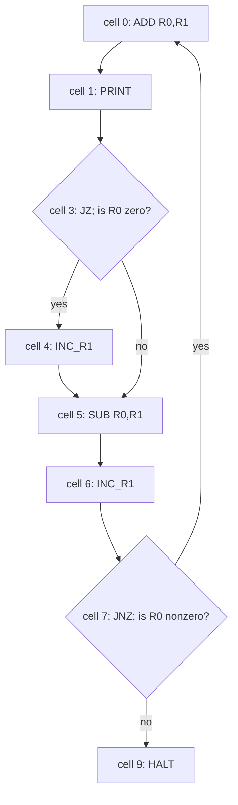

# Length-8 maximal-output programs

## Search convention and result

The length-8 domain is all `16^8 = 4,294,967,296` vectors over nibble values 0–15. Each vector is loaded at cells 0–7 and zero-padded through cell 15. Only halted candidates count toward the score; cyclic candidates are ineligible. The score is the number of decimal characters emitted, so printing a value from 10 through 15 contributes two characters.

The exhaustive C++ enumeration used the same `i4917_detail::run_search_program` core as the production search. It completed the full domain with zero errors. Every tied winner was then passed once to the Haskell CLI's `generalize` command. The resulting patterns below group winners by exact emitted wildcard pattern.

| Length | Candidates | Halted | Cycled | Errors | Best characters | Tied winners |
|---:|---:|---:|---:|---:|---:|---:|
| 8 | 4,294,967,296 | 3,858,727,572 | 436,239,724 | 0 | 482 | 102 |

The exhaustive run took 7m 27.99s wall time (441.66s user time). The 102 `generalize` runs all reported HALTED and 482 output characters. Their outputs yielded 22 distinct patterns: 16 groups of six winners and six singleton groups.

## Common shape and variations

All 102 winners use both registers, and `generalize` reports that R0 contains an R0/R1 combination in every case. All leave cells 10–15 unused. Their instructions and data are concentrated in cells 0–9; the two largest classes have instruction locations `[0,1,3,4,5,6,7,9]` or `[0,2,3,4,5,6,7,9]`, with print data in the other low cell. The six singletons use instructions at `[0,1,2,3,4,5,6,7,9]` and data at `[2,4,5,8]`.

The 16 six-winner patterns share a print operand `x` at the indicated PRINT instruction, where `x` ranges over 10–15. That preserves two characters per print and therefore preserves the 482-character score, while changing the emitted text. The loop/control structure also varies: patterns include ADD/SUB updates to R0, increments or decrements of either register, and JZ/JNZ loop tests. In the six singleton patterns, the output operand is fixed as part of the control-flow arrangement, including JMP/JZ/JNZ alternatives. Their patterns cannot be merged with the 16 six-winner classes merely because the scores agree.

## What the Haskell step traces show

I ran the Haskell CLI `trace` command on **all 102 winning length-8 programs listed here**. Each trace halted, printed 241 values, and reported 482 output characters. The full candidate space of 4,294,967,296 programs was screened by the exhaustive C++ search above; the step-by-step Haskell audit covers every winner, not every losing candidate. The longest trace took 1,897 steps, so `--max-steps 10000` covered them all.

The traces fall into four execution-cost classes. They all print 241 times; the different step totals come from how often a conditional branch takes an extra instruction or a two-instruction detour.

| Trace class | Winners | Extra branch path | Steps including HALT |
|---|---:|---:|---:|
| Six-winner patterns with a JZ path | 48 | One extra instruction on 16 rounds | 1,463 |
| Six-winner patterns with a JNZ path | 48 | One extra instruction on 225 rounds | 1,672 |
| Singleton patterns with a JZ trampoline | 4 | Two extra instructions on 16 rounds | 1,479 |
| Singleton patterns with a JNZ trampoline | 2 | Two extra instructions on 225 rounds | 1,897 |

Here is the state cycle for one representative six-winner program, `[1,8,10,14,4,2,4,15]`:

```text
cell 0: ADD R0,R1
cell 1: PRINT cell 2
cell 3: JZ cell 4
cell 4: INC_R1       ; reached only when the sum in R0 is zero
cell 5: SUB R0,R1
cell 6: INC_R1
cell 7: JNZ cell 8   ; cell 8 is zero, so a nonzero R0 returns to cell 0
cell 9: HALT         ; reached when R0 is zero
```



Registers are four-bit values, so arithmetic wraps modulo 16. On an ordinary round, `ADD` makes R0 equal to `R0 + R1`; the print emits `10`; `JZ` skips cell 4; then `SUB` removes the same R1 value. R0 is back where it started, while the final `INC_R1` advances R1 by one. In state terms, an ordinary round is `(a,b) → (a,b+1)` as long as `a+b` is nonzero modulo 16.

When `a+b` is zero, the JZ branch takes the extra `INC_R1` before `SUB`. The SUB now uses the incremented value, so R0 changes by one modulo 16 instead of cancelling back to `a`; the final increment advances R1 once more. For this program the special transition is `(a,−a) → (a−1,−a+2)`, modulo 16. The first round starts at `(0,0)`, takes this branch immediately, and leaves `(15,2)`. R1 then advances through 15 ordinary rounds until the next `R0+R1=0` event. Each event moves R0 down one value; the event from `(1,15)` leaves R0 at zero, so JNZ falls through to HALT.

That gives **16 zero-hit rounds**, with **15 ordinary rounds between each consecutive pair**: `16 + 15×15 = 241` print rounds. Every print in this representative program is `10`, a two-character value, so `241×2 = 482` characters. The other winners change the arithmetic direction, instruction order, branch polarity, or route to the special update. Their traces confirm the same 241 prints and halt; they are alternate encodings of a long modular counter cycle.

The CLI's final trace lines for the representative show the exit explicitly: after the 241st print, the branch path leaves R0 at zero, JNZ advances to cell 9, and HALT executes at step 1,463. The singleton trampoline patterns reach the same output count through a JMP plus an update on the special path; their longer traces reflect those extra control-flow steps, not extra output.

## Why the score jumps from length 7 to length 8

Length-7 winners print 86 two-digit values, for 172 characters. Length-8 winners print 241 two-digit values, for 482 characters: about 2.8 times as many output rounds and characters. In the representative length-8 layout, the extra program cell makes room for an additional R1 update after the SUB, while the conditional R1 update before SUB still runs only on a zero hit. Together, these updates turn the detected zero into a one-step change in R0 instead of cancelling the accumulator arithmetic. R1 advances through its 16-value phase; each special zero hit changes R0, creating a second, slower phase. The program exits only when those interacting phases bring R0 to zero at the final JNZ.

So the jump is caused by a longer-lived state cycle, not by printing wider values: both lengths' winning loops print two characters each time. Length 8 sustains 241 iterations where length 7 sustains 86. This is the mechanism visible in these winners, not a general rule that every extra program cell multiplies the maximum by the same amount.

The displayed `AnyOf` print class is a useful way to describe a score-preserving output-value family, but it does not make the outputs textually identical. Any search pruning based on this grouping needs validation that it preserves the target objective and the relevant control-flow behavior; matching the character count alone is insufficient if exact output text or pattern identity matters.

## Winners grouped by generalized pattern

Notation `x ∈ {10, 11, 12, 13, 14, 15}` below explicitly denotes the six listed winner vectors for that pattern, with the same `x` substituted in the program. Every vector is an eight-nibble candidate, followed by implicit zero padding to 16 cells. Opcode names follow `InstructionSet.txt`: ADD=1, SUB=2, INC_R0=3, INC_R1=4, DEC_R0=5, DEC_R1=6, PRINT=8, JMP=13, JZ=14, JNZ=15, HALT=0.

### Six-winner patterns

Each row is one exact `generalize` pattern. The `x` in each vector occupies the PRINT operand and is generalized as `Double-char output (10-15)`.

| Pattern | Winner vectors |
|---:|---|
| 1 | `[1,8,x,14,4,2,4,15]`, x=10,11,12,13,14,15 |
| 2 | `[1,8,x,14,4,2,6,15]`, x=10,11,12,13,14,15 |
| 3 | `[1,8,x,15,4,2,3,15]`, x=10,11,12,13,14,15 |
| 4 | `[1,8,x,15,4,3,2,15]`, x=10,11,12,13,14,15 |
| 11 | `[2,8,x,14,4,1,4,15]`, x=10,11,12,13,14,15 |
| 12 | `[2,8,x,14,4,1,6,15]`, x=10,11,12,13,14,15 |
| 13 | `[2,8,x,15,4,1,5,15]`, x=10,11,12,13,14,15 |
| 14 | `[2,8,x,15,4,5,1,15]`, x=10,11,12,13,14,15 |
| 15 | `[8,x,1,14,4,2,4,15]`, x=10,11,12,13,14,15 |
| 16 | `[8,x,1,14,4,2,6,15]`, x=10,11,12,13,14,15 |
| 17 | `[8,x,1,15,4,2,3,15]`, x=10,11,12,13,14,15 |
| 18 | `[8,x,1,15,4,3,2,15]`, x=10,11,12,13,14,15 |
| 19 | `[8,x,2,14,4,1,4,15]`, x=10,11,12,13,14,15 |
| 20 | `[8,x,2,14,4,1,6,15]`, x=10,11,12,13,14,15 |
| 21 | `[8,x,2,15,4,1,5,15]`, x=10,11,12,13,14,15 |
| 22 | `[8,x,2,15,4,5,1,15]`, x=10,11,12,13,14,15 |

### Singleton patterns

Each vector below forms its own distinct generalized pattern:

- Pattern 5: `[1,14,4,8,13,2,4,15]`
- Pattern 6: `[1,14,4,8,13,2,6,15]`
- Pattern 7: `[1,14,4,8,14,2,4,15]`
- Pattern 8: `[1,14,4,8,14,2,6,15]`
- Pattern 9: `[1,15,4,8,13,2,3,15]`
- Pattern 10: `[1,15,4,8,15,2,3,15]`

## Relationship to lengths 1–7

The earlier exhaustive results in [optimal-programs-length-1-to-7.md](../optimal-programs-length-1-to-7.md) show a sharp increase in the best score from 172 characters at length 7 to 482 at length 8. The length-8 winners still follow the same broad pattern of using short loops and 4-bit register state to repeat output, but their 8-cell layouts support more involved counter updates and conditional paths. This comparison describes the observed winners; it does not establish a general growth rule for longer lengths.
