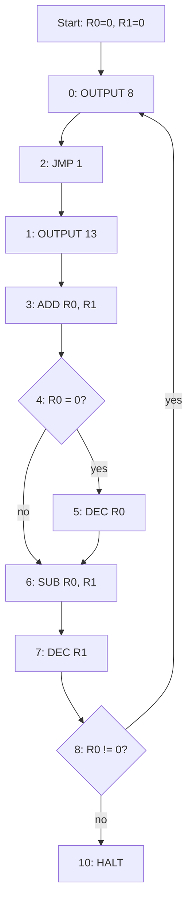

# Length-9 exhaustive search

## Search result

The C++ search CLI exhaustively evaluated all `16^9 = 68,719,476,736` nine-nibble programs. Each candidate occupies memory cells 0–8, with cells 9–15 zero-padded. The search counts output characters for programs that halt; programs that repeat a machine state are classified as cycles and do not qualify. The exhaustive search completed with no execution errors.

| Result | Count |
| --- | ---: |
| Candidates searched | 68,719,476,736 |
| Halted | 60,931,421,044 |
| Cycled | 7,788,055,692 |
| Errors | 0 |
| Maximum output length | 678 characters |
| Tied winners | 1 |

The unique winning program is:

```text
[8, 8, 13, 1, 14, 5, 2, 6, 15]
```

Replaying it with the C++ `run` command halted after 1,825 instructions and emitted 452 values. The output alternates `8, 13` for 226 pairs. Since `8` takes one decimal character and `13` takes two, the total is `226 × (1 + 2) = 678` characters.

Because every candidate in the length-9 domain was checked and the search reported zero errors, 678 is the maximum score for length 9 under this machine and scoring rule. This result does not imply anything about longer program lengths.

## Method and commands

The search used the release build of the `c-impl` CLI. That directory's implementation is C++17 and exposes the processor core through a C ABI; the exhaustive search itself runs through its `4917-cpp` executable.

From `c-impl/`, the build and search commands were:

```sh
cmake --preset release
cmake --build --preset release -j 4
/usr/bin/time -p ./build/make-release/4917-cpp search --length 9 --json
```

The search command took **7,558.18 seconds** wall-clock (2 hours, 5 minutes, 58.18 seconds), with 7,508.51 seconds user CPU time and 41.18 seconds system CPU time. Its JSON result was:

```json
{"schema":"4917-search-v2","length":9,"candidate_count":"68719476736","halted":"60931421044","cycled":"7788055692","errors":"0","exhaustive":true,"best_output_characters":"678","winner_count":"1","first_winner":[8,8,13,1,14,5,2,6,15]}
```

The winner replay command was:

```sh
./build/make-release/4917-cpp run \
  --program 8,8,13,1,14,5,2,6,15 \
  --max-steps 1000000 --json
```

It returned `termination: halted`, `steps: 1825`, and `output_characters: 678`.

## Haskell CLI execution diagnostics

I checked the winner with all three Haskell CLI commands relevant to execution
and inspection. The top-level help lists `run`, `trace`, and `generalize`;
the separate `search`, `solve`, and demo commands do not inspect this supplied
program's execution.

From `haskell-impl/`, the commands were:

```sh
stack run -- run --program 8,8,13,1,14,5,2,6,15 --max-steps 1000000
stack run -- trace --program 8,8,13,1,14,5,2,6,15
stack run -- generalize --program 8,8,13,1,14,5,2,6,15
```

`run` and `trace` both report HALT after **1,825 instructions** and **678
output characters**. The trace has 1,825 instruction rows plus the initial
state and final status. It shows no memory changes, 226 executions of each
PRINT, and 16 times when the conditional jump at address 4 takes the DEC R0
path. The final instructions are JNZ at address 8 falling through to HALT at
address 10, with R0 = 0, R1 = 14, and 678 characters emitted. `generalize`
reports the same steps and score; its memory pattern is detailed below.

## Program layout and control flow

The nine supplied nibbles occupy addresses 0–8. Execution continues in the
same 16-cell memory, where the omitted cells are zero:

| Address | Byte | Instruction | Effect in this program |
| ---: | ---: | --- | --- |
| 0 | 8 | OUTPUT | Print the next cell, 8; advance to address 2. |
| 1 | 8 | OUTPUT | Print the next cell, 13; reached through JMP. |
| 2 | 13 | JMP | Jump to the address stored in cell 3, which is 1. |
| 3 | 1 | ADD R0,R1 | Set R0 to `(R0 + R1) mod 16`. |
| 4 | 14 | JZ 5 | If R0 is zero, take address 5; otherwise skip to address 6. |
| 5 | 5 | DEC R0 | Decrement R0 on the zero-sum path only. |
| 6 | 2 | SUB R0,R1 | Set R0 to `(R0 - R1) mod 16`. |
| 7 | 6 | DEC R1 | Decrement R1 modulo 16. |
| 8 | 15 | JNZ 0 | If R0 is nonzero, return to address 0; otherwise continue at address 10. |
| 9 | 0 | Operand | The JNZ target, address 0. |
| 10 | 0 | HALT | Reached when JNZ falls through. |



The same control flow in pseudocode is:

```text
R0 = 0
R1 = 0
repeat:
    print 8
    print 13
    R0 = (R0 + R1) mod 16
    if R0 == 0:
        R0 = (R0 - 1) mod 16
    R0 = (R0 - R1) mod 16
    R1 = (R1 - 1) mod 16
until R0 == 0
halt
```

The DEC R0 before SUB is essential: it runs only when the addition wraps to
zero. On an ordinary round, ADD followed by SUB restores R0 to its value at
the start of that round, while R1 decreases by one. On a zero-sum round, the
extra decrement makes the new R0 one less than before (modulo 16). The first
round starts at `(0,0)` and seeds R0 to 15. Thereafter each R0 value from 15
down through 1 persists while R1 cycles until `R0 + R1` wraps to zero; that
round lowers R0 and begins the next phase. The phase for each of those 15 R0
values takes 15 rounds. The final zero-sum round changes R0 from 1 to 0, so
JNZ falls through to HALT.

This gives `1 + 15 × 15 = 226` rounds: one initial seed round and 15 phases
of 15 rounds. Every round emits `(8, 13)`, giving 452 values and
`226 × (1 + 2) = 678` output characters. Each round uses eight instructions;
the 16 zero-sum rounds also execute DEC R0 once. Therefore the loop takes
`226 × 8 + 16 = 1,824` instructions, followed by the one HALT instruction,
matching the Haskell trace's 1,825-step count.

## Haskell CLI generalization

The Haskell CLI generalizer was also run on the winning nine-nibble program:

```sh
cd haskell-impl
stack run -- generalize --program 8,8,13,1,14,5,2,6,15
```

It reports a halted execution in 1,825 steps with 678 output characters. Its
optimized 16-cell memory pattern requires addresses 0–10 and leaves addresses
11–15 unused:

```text
[8, 8, 13, 1, 14, 5, 2, 6, 15, 0, 0, Any(0-15), Any(0-15), Any(0-15), Any(0-15), Any(0-15)]
```

The generalizer counts all 16-cell memories, so it reports `16^16` possible
images reduced to `16^5 = 1,048,576` images. The length-9 search domain fixes
cells 9–15 to zero padding; within that domain, every one of the first nine
cells is required, so this pattern admits only the winning length-9 program.
The exhaustive search above, rather than this single-run generalization, is
what establishes the length-9 maximum.

## Interpretation

The winner is a loop-based program that emits an alternating pair of values 226 times before halting. The nine-nibble layout is longer than the previously documented length-8 winners, and its unique maximum is 196 characters above length 8's 482-character maximum. This is a comparison of these two exhaustive results; it does not establish a general growth pattern.
